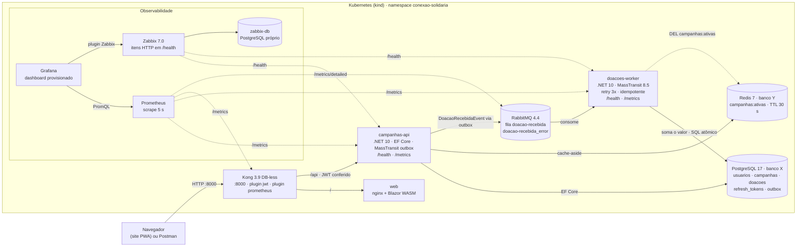

# Arquitetura

Dois microsserviços .NET 10 (`campanhas-api` e `doacoes-worker`), um site Blazor WebAssembly, um API Gateway, dois bancos (PostgreSQL e Redis), um broker (RabbitMQ) e a observabilidade (Prometheus, Grafana e Zabbix com banco próprio), tudo no namespace `conexao-solidaria` de um cluster Kubernetes local (kind).

Versão visual (whiteboard): https://claude.ai/artifact/4vV2GJVZuM5wKxNX8AUmRf

## Componentes

| Componente | Responsabilidade | Detalhes |
|---|---|---|
| Kong | Entrada única; confere assinatura e validade do JWT nas rotas protegidas | DB-less, `kong/kong.yml`; o perfil (GestorONG ou Doador) é conferido pela API (403) |
| web | Site público e área de gestão | Blazor WebAssembly + MudBlazor, nginx com CSP e cabeçalhos de segurança, PWA |
| campanhas-api | Login, cadastro de doadores, campanhas, painel, intenção de doação, consultas da gestão | camadas Domain, Application, Infrastructure e API; outbox do MassTransit no PostgreSQL |
| doacoes-worker | Único serviço que altera o valor arrecadado | consome `DoacaoRecebidaEvent`; transação com `FOR UPDATE`; mensagem repetida não soma duas vezes; doação de campanha encerrada vira `Rejeitada` |
| PostgreSQL (X) | Dados transacionais | unicidade de e-mail e CPF, `CHECK` de meta e valor positivos, índices das listas paginadas |
| Redis (Y) | Cache do painel público | cache-aside de 30 s; a API e o worker apagam a chave quando algo muda; queda do Redis não derruba a API |
| RabbitMQ | Desacopla a doação do processamento | fila e bindings declarados na subida; retry 3x e fila `_error` |
| Prometheus | Métricas | API, worker, Kong e RabbitMQ |
| Grafana | Dashboard | Prometheus e Zabbix como fontes de dados |
| Zabbix + zabbix-db | Disponibilidade | item HTTP por serviço e alerta quando um sai do ar |

## Fluxos

**Doação (assíncrona).**
1. `POST /api/doacoes` com o JWT do doador.
2. O Kong valida o token.
3. A API grava a doação como `Pendente` e o evento no outbox, na mesma transação, e responde `202`.
4. O MassTransit publica na fila `doacao-recebida`.
5. O worker consome, soma o valor e marca `Processada`.
6. O worker apaga o cache; o painel mostra o valor novo na próxima leitura (o site atualiza a cada 5 s).

**Campanha.** Só `GestorONG` cria e edita (`403` para doador). A campanha nasce `Ativa`; término no passado ou meta menor ou igual a zero respondem `400`.

**Sessão.** O login devolve um JWT de 15 minutos e grava o refresh token num cookie HttpOnly. O site guarda o JWT só em memória e o renova em `POST /api/auth/refresh` antes de vencer; cada renovação troca o refresh token, e o reuso de um token já trocado encerra a família de sessões.
